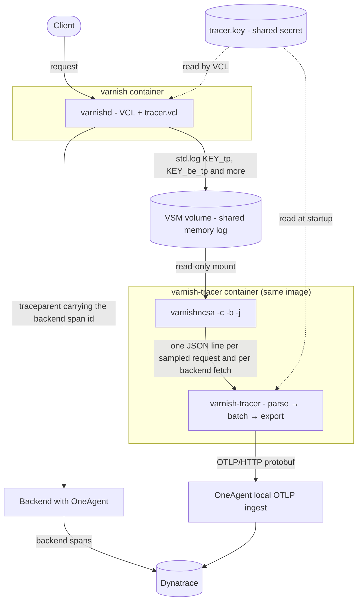
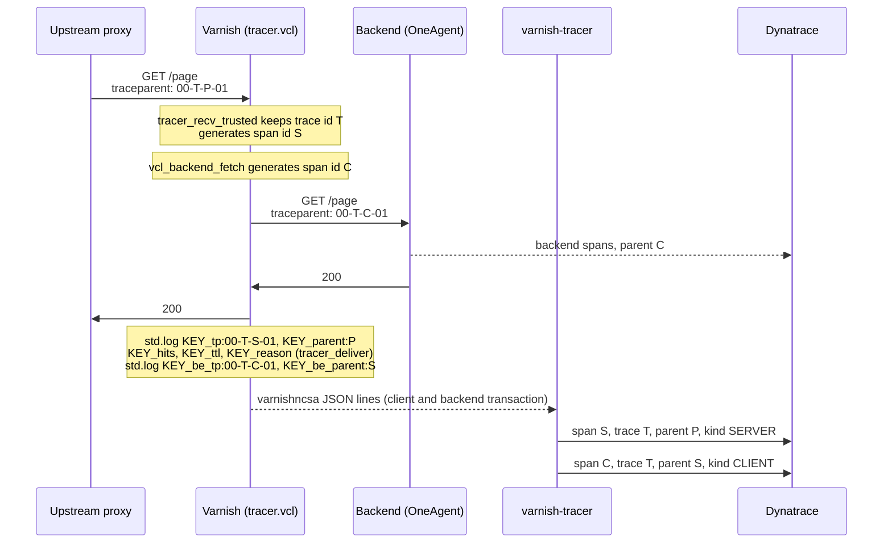

# varnish-tracer

Minimal OpenTelemetry tracing for Varnish Cache: every sampled request handled by Varnish becomes an OTLP `SERVER` span, every backend fetch of such a request a `CLIENT` span below it, exported to a Dynatrace OneAgent (or any OTLP/HTTP receiver) and linked to the backend trace through the W3C `traceparent` header.

It does not read the Varnish shared log on its own: `varnishncsa` does that, including reconnecting after Varnish restarts, and `varnish-tracer` turns its JSON output into spans.

## Architecture



Trace context through a cache miss, with a trusted upstream that already traces:



Requests from untrusted clients lose any `traceparent` they send: Varnish samples them itself and starts a new trace.

Cache hits produce a `SERVER` span only: they never reach the backend, so there is no `CLIENT` span below them.

## Components

### `vcl/tracer.vcl`

VCL include that owns the trace context. It requires the `blobdigest` vmod (`blob` and `std` are built in) and must be in Varnish's `vcl_path`. The include must come before the including VCL's own subs: the file defines `vcl_backend_fetch`, `vcl_pipe` and `vcl_backend_response`, and VCL runs the definitions of a built-in sub in include order.

#### Log key

Every record `tracer.vcl` writes with `std.log` is prefixed with a shared secret key instead of a fixed word: `<key>_tp:`, `<key>_parent:`, `<key>_be_tp:`, `<key>_be_parent:`, `<key>_hits:`, `<key>_ttl:` and `<key>_reason:`. `varnishncsa` only selects records with that prefix, so a VCL that logs client data after a fixed `tracer_tp:` prefix can no longer forge a span; only code that knows the key can.

- The key is the content of `/etc/varnish/tracer.key`: 32 lowercase hex characters, trailing whitespace such as a newline allowed. Generate it with `openssl rand -hex 16`.
- The VCL reads it with `std.fileread`, which caches the content per call site until the VCL is reloaded. The binary reads it from `--key-file` at startup and exits with code 2 when the file is missing, unreadable or invalid; it never prints the key. `--stdin` does not read it.
- If the file is missing or does not hold 32 hex characters, tracing is disabled entirely: `tracer_start`, `tracer_restart`, `tracer_deliver` and the backend span in `vcl_backend_fetch` do nothing and log nothing, and no `traceparent` is generated. `tracer_recv` still removes the client's trace headers, and `tracer_recv_trusted` still validates the upstream `traceparent` and forwards it unchanged. The VCL still compiles, and a key file that appears later is picked up by the call sites that have not read it yet, so reload the VCL after creating it.
- Rotating the key needs a VCL reload (`varnishadm vcl.load` and `vcl.use`) and a restart of `varnish-tracer`; spans logged under the old key are lost between the two steps.
- The records carry the key in clear text in the shared log, so everyone who can read the Varnish working directory can read the key too. Mount that directory read-only into the tracer container only, and keep the key file readable by `varnishd` and `varnish-tracer` alone.

#### Subroutines

| Subroutine | What it does |
|---|---|
| `tracer_recv` | Entry point for requests from untrusted clients: removes `traceparent`, `tracestate`, the Dynatrace server-side tags (`x-dynatrace`, `x-dynatrace-application`, `x-dynatrace-requeststate`) and `X-Tracer-*` request headers, so clients can neither force sampling nor choose trace ids. `x-dtpc`, sent by browsers for Dynatrace RUM, is kept. |
| `tracer_recv_trusted` | Entry point for requests from a trusted upstream: removes `X-Tracer-*`, collapses duplicate `traceparent` headers, drops a malformed `traceparent` together with `tracestate`, and calls `tracer_start` when the upstream sampled the request (flags with the sampled bit). An unsampled upstream `traceparent` is forwarded unchanged, together with `tracestate` and the Dynatrace tags, so the backend still continues the upstream trace. |
| `tracer_start` | Does nothing when the key is invalid. Otherwise keeps the incoming trace id or creates one, generates the Varnish span id from two random values, the server identity, the transaction id and the time, rewrites `traceparent` for the backend, removes `tracestate` and the Dynatrace server-side tags (which carry the upstream parent and would make the backend skip the Varnish span), and logs `<key>_parent:<upstream span id>` (when there is one) and `<key>_tp:<traceparent>`. It stores the upstream span id in `X-Tracer-Parent` and its own in `X-Tracer-Span`, and does nothing when `X-Tracer-Span` is already set. |
| `tracer_deliver` | To be called from the including VCL's `vcl_deliver`. For a traced request it logs `<key>_hits:<obj.hits>` and `<key>_ttl:<obj.ttl>`, and `<key>_reason:<X-Tracer-Reason>` when the including VCL has set that request header. |
| `vcl_backend_fetch` | For a traced fetch (`X-Tracer-Span` set, valid key, valid `traceparent`) generates a new span id for the backend request with the same hashing as `tracer_start` and the backend transaction id, logs `<key>_be_tp:00-<trace id>-<new id>-01` and `<key>_be_parent:<Varnish span id>`, and sends that `traceparent` to the backend. Then removes `X-Tracer-Parent`, `X-Tracer-Span`, `X-Tracer-Id` and `X-Tracer-Reason` from the backend request. |
| `vcl_pipe` | Removes the same four internal headers; piped requests get no backend span and the backend sees the Varnish span id in `traceparent`. |
| `vcl_backend_response` | When `bereq.uncacheable` is false, removes the `traceparent`, `tracestate` and `traceresponse` response headers and the `dt*` entries of `Server-Timing` (joining repeated `Server-Timing` headers first, and dropping the header when nothing else is left), so the ids of one request are never replayed from the cache to other users. Uncacheable fetches, such as passes, keep these headers. |

Both entry points also handle two special cases and then return:

- ESI fragments (`req.esi_level > 0`) drop any client-supplied trace headers and take the `traceparent` of the top request, so they are children of its Varnish span; they never produce a span of their own and their backend fetches get no `CLIENT` span.
- Restarts (`req.restarts > 0`) log `<key>_tp` again, and `<key>_parent` when `X-Tracer-Parent` is set, if the first pass started a span. A restart is a separate transaction for `varnishncsa`, so this keeps one span line per restarted request.

A retried backend fetch keeps the span id of its first attempt, because the internal headers are already gone from the retried request. A fetch started in the background (grace) belongs to the request that triggered it, so its `CLIENT` span can end after that request's `SERVER` span.

The including VCL picks the entry point with its own ACL and decides the sampling of requests that arrive without a `traceparent`:

```vcl
import std;

acl tracer_upstream {
    "127.0.0.1"/32;   # a OneAgent-instrumented proxy on the same host
}

include "tracer.vcl";

sub vcl_recv {
    if (remote.ip ~ tracer_upstream) {
        call tracer_recv_trusted;
    } else {
        call tracer_recv;
    }
    if (!req.http.traceparent && req.restarts == 0 && req.esi_level == 0 && std.random(0, 1) < 0.1) {
        call tracer_start;
    }
    # ...
}

sub vcl_deliver {
    # Optional: a label that explains the caching decision, exported as varnish.cache_reason
    if (resp.http.X-Cacheable) {
        set req.http.X-Tracer-Reason = resp.http.X-Cacheable;
    }
    call tracer_deliver;
    # ...
}
```

Requests that should never become spans, such as health checks, must return before these calls. `X-Tracer-Reason` is removed from client requests like the other `X-Tracer-*` headers and never reaches a backend; set it before `call tracer_deliver`.

### `varnish-tracer`

A single static binary that:

1. validates its configuration and exits with code 2 and a message when the endpoint, a header, the compression, the CA file, the key file (unless `--stdin`) or the metrics address is invalid or unusable;
2. starts `varnishncsa -c -b` as a child process, attached to the Varnish working directory, selecting the transactions with a `VCL_Log:<key>_tp` or `VCL_Log:<key>_be_tp` record and printing a fixed JSON format built at runtime from the key; its stderr is copied to ours with a `varnishncsa: ` prefix, and lines containing `overrun` are counted as `vsl_overruns`, since a VSL overrun silently loses records;
3. turns each line into an OTLP span, a `SERVER` span for a client transaction and a `CLIENT` span for a backend transaction; invalid UTF-8 is replaced with U+FFFD, lines over 64 KiB are skipped and counted as `malformed`, records whose start timestamp is 0 are rejected, and so are backend records without a valid parent span id;
4. buffers spans in a bounded queue and exports them in batches over OTLP/HTTP protobuf, gzip-compressed on request;
5. drops spans instead of growing when the receiver is slow or down, and reports counters on stderr once a minute: `exported`, `dropped_queue`, `dropped_export`, `malformed` and `vsl_overruns`; the same counters are available as Prometheus metrics when `--metrics-listen` is set;
6. exits when `varnishncsa` exits, so the container restart policy brings both back; `SIGTERM` stops `varnishncsa` (`SIGKILL` after 5 s), flushes the queue for at most 3 s without retries, counts what is left as `dropped_export` and exits cleanly. If the exporter is still busy 0.5 s after that deadline, the spans of its in-flight batch and everything still queued are counted as `dropped_export` before the final report, and the process exits anyway.

`varnishncsa` is signalled through a pidfd opened right after it is spawned, so a recycled pid can never receive the signal; only a failing `pidfd_open` (a kernel without it, or a seccomp filter refusing it) makes the binary fall back to `kill(2)`, which is skipped once the child has been reaped.

Export behaviour:

- Environment proxies (`HTTP_PROXY`, `ALL_PROXY`) are ignored and redirects are not followed.
- With `--compression gzip` the protobuf body is gzip-compressed once per batch and sent with `Content-Encoding: gzip`.
- For `https://` endpoints the bundled webpki roots are used, or only the certificates of `--ca-file` when it is set.
- A 2xx response is a success; when its body carries `partial_success`, the rejected spans are counted as `dropped_export` instead of `exported` and the receiver's message is logged.
- Network errors, timeouts and the statuses 429, 502, 503 and 504 are retried up to three times after 1 s, 2 s and 4 s; on 429 and 503 a `Retry-After` in seconds (capped at 30 s) replaces the delay of that attempt.
- An invalid request, URL or header, a redirect and any other status are not retried; the batch is dropped and counted as `dropped_export`.
- Text from the receiver and from `varnishncsa` is cut to 256 characters and control characters are escaped before it is logged.

Dry run: with `--dry-run` nothing is exported and no HTTP request is made; each span is printed on stdout as one JSON object per line and counted as `exported`. The keys are sorted alphabetically:

```json
{"attributes":{"http.request.method":"GET","url.path":"/page","varnish.hits":0},"end_time_unix_nano":1793455717323545000,"kind":"SERVER","name":"GET","parent_span_id":"","span_id":"b7ad6b7169203331","start_time_unix_nano":1793455717323367000,"status":null,"trace_id":"0af7651916cd43dd8448eb211c80319c"}
```

`trace_id`, `span_id` and `parent_span_id` are hex (the parent is an empty string for a root span), the times are unix nanoseconds as JSON numbers, `kind` is `SERVER` or `CLIENT`, `attributes` maps the attribute names to their values and `status` is `null` or `{"code":"ERROR"}`.

Metrics: with `--metrics-listen ADDR:PORT` a small HTTP server runs on its own thread and answers `GET /metrics` with the Prometheus text format; every other method and path gets a 404. It reads the request head within 2 s and at most 8 KiB, handles one connection at a time, and only reads the counters, so it can never slow the pipeline down. There is no authentication or TLS: bind it to a loopback or a private address.

| Metric | Type | Meaning |
|---|---|---|
| `varnish_tracer_spans_exported_total` | counter | spans accepted by the receiver (or printed with `--dry-run`) |
| `varnish_tracer_spans_dropped_total{reason="queue"}` | counter | spans dropped because the queue was full |
| `varnish_tracer_spans_dropped_total{reason="export"}` | counter | spans dropped after a failed export, rejected by the receiver, or left over at the shutdown deadline |
| `varnish_tracer_lines_malformed_total` | counter | `varnishncsa` lines that were too long or not a valid record |
| `varnish_tracer_vsl_overruns_total` | counter | shared log overruns reported by `varnishncsa` |
| `varnish_tracer_queue_spans` | gauge | spans waiting in the queue |
| `varnish_tracer_up` | gauge | always 1 |

### Span contents

Both span kinds use the trace id and span id from the log record (`<key>_tp` for a client transaction, `<key>_be_tp` for a backend transaction).

| Field | `SERVER` span (client transaction) | `CLIENT` span (backend fetch) |
|---|---|---|
| name | HTTP method | HTTP method |
| kind | `SERVER` | `CLIENT` |
| parent span id | from `<key>_parent`, empty for traces started by Varnish | the Varnish span id, from `<key>_be_parent`; records without it are dropped as malformed |
| start | `Timestamp:Start` | `Timestamp:Start` of the backend transaction |
| end | `Timestamp:Resp`, else start plus the logged duration | `Timestamp:BerespBody`, else `Timestamp:Error`, else `Timestamp:Beresp`, else start plus the logged duration |
| status | `ERROR` for 5xx responses, unset otherwise | `ERROR` for 5xx responses and for fetch errors (a `FetchError` record or a `Timestamp:Error`), unset otherwise |

Every string value, the span name included, is cut to 1024 bytes on a UTF-8 boundary.

`SERVER` span attributes:

| Attribute | Source |
|---|---|
| `http.request.method` | request method |
| `url.path` | request path |
| `url.query` | query string, only with `--include-query` |
| `server.address`, `server.port` | `Host` header |
| `network.protocol.version` | HTTP version |
| `http.response.status_code` | response status |
| `http.response.body.size` | response body bytes, 0 when Varnish logs `-` |
| `user_agent.original` | `User-Agent` header |
| `varnish.handling` | `hit`, `miss`, `pass`, `pipe` or `synth` |
| `varnish.time_to_first_byte` | seconds from request start to first byte |
| `varnish.vxid` | transaction id, for `varnishlog -q 'vxid == N'` |
| `varnish.hits` | integer, `obj.hits` logged by `tracer_deliver` |
| `varnish.ttl` | double, `obj.ttl` in seconds logged by `tracer_deliver`, negative while the object is in grace |
| `varnish.cache_reason` | string, `X-Tracer-Reason` logged by `tracer_deliver` |

`varnish.hits`, `varnish.ttl` and `varnish.cache_reason` are only present when the including VCL calls `tracer_deliver` (and sets `X-Tracer-Reason`).

`CLIENT` span attributes:

| Attribute | Source |
|---|---|
| `http.request.method` | backend request method |
| `url.path` | backend request path |
| `http.response.status_code` | backend response status, 503 for a synthetic fetch error |
| `varnish.backend` | backend name, from the `BackendOpen` record; absent when the connection could not be opened |
| `varnish.time_to_first_byte` | seconds from the start of the backend transaction to the response headers |
| `varnish.vxid` | backend transaction id |

Resource attributes: `service.name`, the `telemetry.sdk.*` set, and anything else in `OTEL_RESOURCE_ATTRIBUTES`; the configured service name wins over a `service.name` there, and `telemetry.sdk.*` keys there are ignored.

## Configuration

Every option can be set as a flag or through its environment variable, except `--header`; the OpenTelemetry variables follow the standard names. Out-of-range values are rejected at startup.

| Flag | Environment | Default | Meaning |
|---|---|---|---|
| `--endpoint` | `OTEL_EXPORTER_OTLP_TRACES_ENDPOINT` | `http://localhost:14499/otlp/v1/traces` | OTLP/HTTP traces URL, an absolute `http://` or `https://` URL; the default is the OneAgent local ingest |
| | `OTEL_EXPORTER_OTLP_ENDPOINT` | none | base URL; when neither the flag nor the traces variable is set, `<base>/v1/traces` is used |
| `--header NAME=VALUE` | | none | extra request header, repeatable and never split on commas; the value is percent-decoded, e.g. `Authorization=Api-Token%20…` for an ActiveGate or SaaS endpoint |
| | `OTEL_EXPORTER_OTLP_HEADERS` | none | extra request headers, `n1=v1,n2=v2`; applied before the `--header` ones |
| `--compression` | `OTEL_EXPORTER_OTLP_TRACES_COMPRESSION` | `none` | request compression, `none` or `gzip`; gzip sets `Content-Encoding: gzip` |
| | `OTEL_EXPORTER_OTLP_COMPRESSION` | none | used when neither the flag nor the traces variable is set; any other value is rejected at startup |
| `--ca-file` | `OTEL_EXPORTER_OTLP_TRACES_CERTIFICATE` | none | PEM file whose certificates are the only trust roots for `https://` endpoints, replacing the bundled webpki roots; it must hold at least one certificate and nothing malformed, up to 4 MiB |
| | `OTEL_EXPORTER_OTLP_CERTIFICATE` | none | used when neither the flag nor the traces variable is set |
| `--service-name` | `OTEL_SERVICE_NAME` | `varnish` | `service.name` resource attribute |
| | `OTEL_RESOURCE_ATTRIBUTES` | none | extra resource attributes, `k1=v1,k2=v2` |
| `--key-file` | `VARNISH_TRACER_KEY_FILE` | `/etc/varnish/tracer.key` | file with the shared log key, 32 lowercase hex characters; not read with `--stdin` |
| `-n`, `--instance` | `VARNISH_TRACER_INSTANCE` | `/var/lib/varnish/varnishd` | Varnish working directory, passed to `varnishncsa -n` |
| `--varnishncsa` | `VARNISH_TRACER_VARNISHNCSA` | `varnishncsa` | path of the `varnishncsa` binary |
| `--stdin` | | off | read `varnishncsa` JSON lines from stdin instead of starting it; EOF flushes and exits 0, signals use their default action |
| `--include-query` | `VARNISH_TRACER_INCLUDE_QUERY` | off | add `url.query`; query strings may carry personal data |
| `--dry-run` | `VARNISH_TRACER_DRY_RUN` | off | print each span as one JSON line on stdout instead of exporting it; no HTTP request is made |
| `--metrics-listen` | `VARNISH_TRACER_METRICS_LISTEN` | off | `ADDR:PORT` of the Prometheus endpoint, e.g. `127.0.0.1:9132`; a bind failure is a startup error |
| `--batch-size` | `VARNISH_TRACER_BATCH_SIZE` | `512` | spans per export request, 1 to 10000 |
| `--batch-timeout-ms` | `VARNISH_TRACER_BATCH_TIMEOUT_MS` | `5000` | longest wait before exporting a partial batch, 1 to 60000 |
| `--queue-size` | `VARNISH_TRACER_QUEUE_SIZE` | `8192` | spans buffered before new ones are dropped, 1 to 1000000 |
| `--export-timeout-ms` | `VARNISH_TRACER_EXPORT_TIMEOUT_MS` | `10000` | timeout of one export request, 100 to 120000 |

The OneAgent local OTLP ingest has to be enabled on the host; check the endpoint against the OneAgent version in use.

## Security notes

- Log records are only trusted with the shared key as prefix: a `std.log("tracer_tp:" + …)` or a record with any other key is ignored by `varnishncsa`, so client data logged by the including VCL cannot forge a span. Never `std.log` client-controlled data with the key as prefix, and never log the key itself.
- The key is visible to everyone who can read the shared log (it is the prefix of every record) and the key file; protect the Varnish working directory and the file like a credential, and rotate it with a VCL reload plus a tracer restart.
- Use `tracer_recv_trusted` only for upstreams that set their own trace context, such as a OneAgent-instrumented proxy on the same host, and match them on `remote.ip`. A proxy that relays client headers unchanged (a plain load balancer) must not be trusted: through it any client could choose trace ids and force sampling.
- The path and the user agent are client-controlled and exported as span attributes (and printed by `--dry-run`); the query is exported only with `--include-query`.
- `tracer.vcl` removes `traceparent`, `tracestate`, `traceresponse` and the Dynatrace `Server-Timing` entries from cacheable backend responses, so a backend that echoes them cannot make Varnish replay the ids of the first requester to other users. Uncacheable responses (passes) are not touched; the including VCL decides what clients see there.
- `X-Tracer-Reason` and the other `X-Tracer-*` request headers sent by clients are removed by `tracer_recv` and `tracer_recv_trusted`, and none of them reaches a backend.
- The metrics endpoint has no authentication and no TLS: bind it to a loopback or private address.
- `--ca-file` replaces the bundled roots; keep it as narrow as the receiver's issuing CA.

## Deployment

The binary and `tracer.vcl` ship in the Varnish image. `varnish-tracer` runs as a second container from that image, with the volume holding the Varnish working directory mounted read-only, the same user as `varnishd` and the key file that `varnishd` also reads:

```sh
openssl rand -hex 16 > tracer.key
docker run -d --name varnish-tracer \
  --network host \
  --restart always \
  -v varnish_dir:/var/lib/varnish:ro \
  -v ./tracer.key:/etc/varnish/tracer.key:ro \
  -e OTEL_SERVICE_NAME=varnish-example \
  <varnish image> varnish-tracer
```

## Releases

Every `v*` tag builds static musl binaries on native GitHub runners and publishes them with the release:

| Asset | Content |
|---|---|
| `varnish-tracer-x86_64-linux-musl` | binary for amd64 |
| `varnish-tracer-aarch64-linux-musl` | binary for arm64 |
| `tracer.vcl` | the VCL include of the same version |
| `SHA256SUMS` | checksums of the three files above |

Images that embed the tracer should download the asset for their architecture and verify it against a checksum pinned in their own build files, not against the `SHA256SUMS` downloaded next to it.

## Build

```sh
cargo build --release
cargo test
```

The release binaries are built inside `rust:alpine`, which produces a static musl binary for the host architecture:

```sh
docker run --rm -v "$PWD:/src" -w /src rust:alpine sh -ec 'apk add --no-cache musl-dev; cargo build --release --locked'
```

## License

`varnish-tracer` is licensed under GPL-3.0-or-later, see [LICENSE](LICENSE).

`vcl/tracer.vcl` is licensed under BSD-2-Clause, as stated in its header, so it can be included in any VCL.
